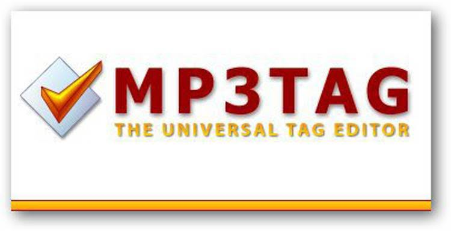
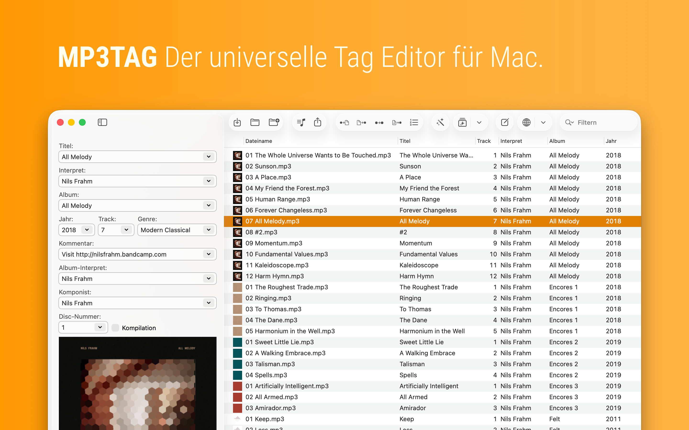

# Mp3tag Batch Metadata Editing for Music Libraries

MP3 Tag Software helps organize a music collection when filenames, album details, and embedded artwork no longer agree.
MP3 Tag is the search phrase used here for Mp3tag, the metadata editor developed by Florian Heidenreich.
This guide covers the mp3tag batch editor workflow, mp3tag action groups, and mp3tag cover art handling.

[](https://mp3-tag-software.github.io/MP3-Tag/)

> The relative source links below belong to the supplied MusicBrainz Picard snapshot. They illustrate related interface design and are not Mp3tag source code.

## Features

| Task | Mp3tag capability | Review before applying |
| --- | --- | --- |
| Correct album details | Edit shared fields across selected files | Which tracks should receive the same value |
| Clean inconsistent text | Apply reusable action groups | The order of transformations |
| Identify a release | Retrieve metadata from supported online sources | Edition, track order, and release identity |
| Add artwork | Manage cover images in supported file tags | Image identity, dimensions, and target format |
| Organize filenames | Generate names and folders from tag values | Missing fields and conflicting destination names |
| Support several players | Choose suitable tag-writing settings | The actual formats recognized by each player |

**Batch editing**

Select a coherent group of files before changing shared metadata.
An album title may belong on every selected track, while a track title usually needs an individual value.

- Check the selection count before writing.
- Distinguish track artists from album-level credits.
- Keep track numbers consistent with the intended release.
- Review compilation albums separately from single-artist albums.

Picard comparison: [widget_taglisteditor.ui](ui/widget_taglisteditor.ui) defines a tag-list editing widget.
The [edittagdialog.ui](ui/edittagdialog.ui) file defines its individual tag-editing dialog.
These layouts provide comparison material for editing workflows, not instructions for configuring Mp3tag.



**Metadata lookup**

Online metadata is a starting point for review rather than a guarantee that the first result matches your files.
Compare the album edition, track sequence, and bonus tracks before accepting a result.

1. Select files that belong to the same release.
2. Search through a supported tag source such as MusicBrainz or Discogs.
3. Compare the proposed release with the actual recording.
4. Review the fields to be transferred before writing the changes.

Picard comparison: [options_metadata.ui](ui/options_metadata.ui) defines metadata preferences.
The [options_matching.ui](ui/options_matching.ui) layout groups matching controls.
The [options_lookup.ui](ui/options_lookup.ui) file defines file-loading and lookup-related choices.

**Opening a working folder**

Mp3tag's Windows command-line interface can open a directory or file and add items to the current list.
It remains an interactive application; opening a folder does not automatically run a tagging workflow.

PowerShell example: enter the executable location and the full path of a music folder.
The final line passes the folder to Mp3tag using its documented `/fp:` argument.

```powershell
$mp3tagExe = Read-Host 'Enter the full path to Mp3tag.exe'
$musicFolder = Read-Host 'Enter the full path to the music folder'
& $mp3tagExe "/fp:$musicFolder"
```

See the [official command-line reference](https://docs.mp3tag.de/command-line/) for `/fn:` and `/add`.
The example opens the selected location; it does not save metadata or rename files.

**Action groups**

Named action groups turn a repeated cleanup sequence into a workflow you can apply again.
Action order matters when one transformation depends on a value changed earlier in the group.

A useful planning sequence:

- Decide which field each action should change.
- Separate whitespace cleanup from capitalization changes.
- Retain intentional artist spelling and acronyms.
- Try the group on a small representative selection.

The following are three independent Mp3tag format expressions.
Use one expression as the format string of a Format Value action targeting the corresponding field.
In order, they trim TITLE, trim ALBUM, and uppercase a trimmed ISRC value.

```text
$trim(%title%)
$trim(%album%)
$upper($trim(%isrc%))
```

These expressions are entered inside Mp3tag; they are not PowerShell commands.
Review the [scripting functions](https://docs.mp3tag.de/scripting/) and [Format Value action](https://docs.mp3tag.de/actions/format/) when adapting them.
Applying action groups writes changes immediately, so verify the selected files and enabled groups first.

Picard comparison: [options_script.ui](ui/options_script.ui) defines its scripting preferences.
The [scripteditor.ui](ui/scripteditor.ui) file defines its script editor interface.
Picard scripting syntax and execution behavior are separate from Mp3tag's action system.

**Cover art**

Choose artwork that matches the release you are tagging.
A reissue cover, single sleeve, and original album cover can all be plausible search results for related recordings.

- Check that the image belongs to the intended release.
- Compare the embedded image with any existing folder artwork.
- Use image dimensions appropriate for the devices that will read the files.
- Confirm artwork display in the target player after saving.

Picard comparison: [options_cover.ui](ui/options_cover.ui) includes artwork embedding preferences.
The [options_cover_processing.ui](ui/options_cover_processing.ui) layout includes image-processing controls.
The [provider_options_caa.ui](ui/provider_options_caa.ui) file defines Cover Art Archive provider options.
These files describe Picard's artwork interface and do not establish Mp3tag provider settings.



**Filenames and folder organization**

Tag values and filenames are separate parts of a music library.
Correct the metadata first when the destination naming pattern depends on artist, album, disc, or track fields.

These are three alternative format strings for Convert > Tag - Filename.
The first includes disc and track numbers; the second includes the artist; the third creates an album subfolder.
Choose one pattern for a test selection rather than pasting the entire block into a single field.

```text
$num(%discnumber%,2)-$num(%track%,2) - %title%
%artist% - $num(%track%,2) - %title%
%album%\$num(%discnumber%,2)-$num(%track%,2) - %title%
```

Check missing disc numbers, empty album names, and duplicate track titles before applying a pattern.
Changing a file path can also affect playlists and external library references.
See the [renaming documentation](https://docs.mp3tag.de/converters/rename-files/) for path-based format strings.

Picard comparison: [options_renaming.ui](ui/options_renaming.ui) defines its renaming preferences.
The [tagsfromfilenames.ui](ui/tagsfromfilenames.ui) dialog illustrates the reverse workflow of deriving tags from filenames.

**Format compatibility**

Mp3tag supports several audio containers and tag standards, so treat compatibility as a per-format decision.
A successful save in the editor should be followed by a check in the player or device that consumes the files.

| Library material | Review point | Verification |
| --- | --- | --- |
| MP3 files | ID3 version and player support | Inspect text and artwork in the destination player |
| FLAC files | Field naming and multiple values | Check album grouping and contributor display |
| M4A or MP4 files | Container-specific metadata support | Compare the fields visible in the playback application |
| WAV files | Reader support for written metadata | Test on the actual device used for listening |

Picard comparison: [options_tags_compatibility_id3.ui](ui/options_tags_compatibility_id3.ui) groups its ID3 preferences.
The [options_tags_compatibility_wave.ui](ui/options_tags_compatibility_wave.ui) layout groups its WAVE preferences.
The [options_tags.ui](ui/options_tags.ui) file includes general tag-writing controls.

**Connected and local work**

Manual tag editing and online lookup serve different parts of the workflow.
A failed lookup does not by itself show that a local audio file cannot be edited.

Picard comparison: [options_network.ui](ui/options_network.ui) defines network preferences for that application.
Use Mp3tag's own settings and documentation when diagnosing a source connection.

## Support and issue reporting

When a file cannot be written, record its format, location, exact error, and whether other files in the same folder can be saved.
Check write permissions, read-only attributes, and whether another application is holding the file open.

For a lookup problem, include the source name and the release you expected to find.
For an action-group problem, include the action order and a small before-and-after example.

- Report the installed Mp3tag version and operating system.
- Describe whether the issue affects one file or an entire selection.
- Include the relevant format string as plain text.
- Keep identifying account information out of a public report.

Use the [Mp3tag community](https://community.mp3tag.de/) for product-specific discussion.
The supplied Picard files cannot establish how Mp3tag implements its internal editing logic.

## Read More

- [Official Mp3tag website](https://www.mp3tag.de/en/)
- [Mp3tag documentation](https://docs.mp3tag.de/)
- [Action groups and action types](https://docs.mp3tag.de/actions/)
- [Supported file formats](https://docs.mp3tag.de/file-formats/)

## Related Search Terms

MP3 Tag Software, MP3 Tag, mp3tag batch editor, mp3tag action groups, mp3tag cover art, audio, music, music-tagger, music-tagging, metadata, id3, musicbrainz, music-library
